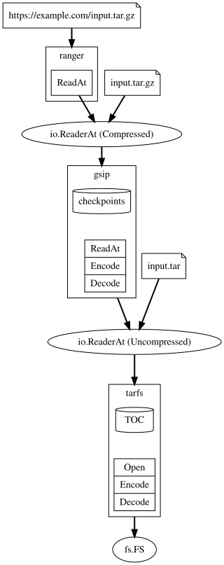

# targz

[](https://pkg.go.dev/github.com/jonjohnsonjr/targz)

This module is a collection of packages relating to gzipped tarballs.

Taken together, they allow for fast random access of a filesystem within a gzipped tarball.

This is primarily a proof of concept of the interfaces and how they compose:



## Packages

### deflate debugger

`deflate` is an experimental, bit-exact DEFLATE trace engine. Unlike a normal
decompressor, its primary output is a queryable instruction stream: every
literal, stored run, and match records both its compressed-bit span and its
uncompressed output range. Match provenance can be followed through
overlapping back-references to the literal or stored byte which originated a
value.

Print a trace and follow one output byte back to its origin:

```console
go run ./cmd/deflate-debug -origin 100 archive.tar.gz
```

Or launch the interactive debugger:

```console
go run ./cmd/deflate-debug-web archive.tar.gz
```

The web debugger is a dense, three-pane workbench: compressed input and decoded
output, the instruction stream, and the relationships behind the current
selection. Selecting an output byte highlights the exact compressed bits which
produced its operation, including distinct Huffman-code and extra-bit spans,
and reports the local expansion ratio.
Back-references show their normalized seed beside the bytes they produce;
dynamic blocks show the literal/length and distance paths side by side, from
payload bits through the generated Huffman tables and back to the dynamic
header which declared them. Decoded output can switch between a hex-editor view
and a readable ASCII view without losing byte-level selection or highlighting.
Hover a byte or character to preview its producing compressed bits; click to
pin it and trace its ancestry. Use `j`/`k` to step through operations and
`[`/`]` to page the trace. It binds to a random localhost port by default.

#### `gzpls`: IDE-grade language intelligence for gzip

`gzpls` is a small LSP 3.17 server which maps DEFLATE provenance onto an IDE's
call hierarchy. A match "calls" the earlier instructions which produced its
normalized source seed. Its incoming calls are later matches which consume the
bytes it produced. Literals are constants and matches are functions, obviously.

The easiest Neovim setup is the small repo-supplied configuration, which owns
only gzip/tar buffers, renders their virtual document, starts the server, keeps
generated targets attached, and defines `gd`, `gri`, `grr`, and `K`:

```lua
dofile("/absolute/path/to/targz/contrib/gzpls.lua").setup({
  cmd = { "/absolute/path/to/gzpls" },
})
```

Install the command once, restart Neovim, and open an archive directly:

```console
go install ./cmd/gzpls
nvim archive.tar.gz
```

Place the cursor on a directory or file name and press `gd`. Directories open
their immediate children; files open their decoded contents. `gri` crosses into
the DEFLATE operations which physically produce the selected entry, and `grr`
finds links or copies which refer to it.

The default `auto` view is content-first. Tar payloads open as directories,
ordinary non-tar gzip payloads open as decoded text with the underlying
filetype, and binary payloads open as compact hex dumps. Use `disassemble -view
trace` when the DEFLATE instruction stream itself should be the starting view.
Archive opening is asynchronous: Neovim immediately shows a small animated
progress buffer with the current inspection/index/render phase and known sizes,
then atomically replaces it with the stable document before attaching the LSP.

For clients other than Neovim, first produce the textual document the server
operates on:

```console
go run ./cmd/gzpls disassemble archive.tar.gz > archive.tar.gz.deflate
```

Then configure an LSP client to associate `*.deflate` with this command:

```console
go run ./cmd/gzpls serve
```

The generated document starts with the absolute path of its compressed source.
Trace documents reparse that source when the document opens, so the server can
answer
`textDocument/prepareCallHierarchy`, `callHierarchy/incomingCalls`,
`callHierarchy/outgoingCalls`, and hover requests using the bit-exact trace. It
also maps the editor's most important navigation commands onto provenance:

- **Go to Definition** jumps from a match to the operations which immediately
  produce its normalized source seed. Definition results are `LocationLink`s:
  the origin selects the match's exact `seed[...]` token, the destination
  selects the producer's `out[...]` token, and the complete instruction remains
  available as target context.
- **Find References** finds later matches which directly consume this
  operation's output.
- **Go to Implementation** follows the dependency graph through matches to the
  literal or stored operations which ultimately introduced the bytes. These
  results use the same token-precise links.
- **Rename** is available on literal tokens. Entering a replacement byte follows
  every transitive copy, atomically rewrites the compressed source, recomputes
  affected gzip trailers, and returns a workspace edit containing the refreshed
  disassembly. Exact gzip headers and unaffected members are retained byte for
  byte; affected members receive fresh DEFLATE bodies, so their block layout may
  change. `gzpls/renameImpact` remains a non-mutating structured preview for
  editor integrations.

Raw streams can be generated with `disassemble -raw`.

The default `auto` view recognizes decoded tar streams by parsing their headers
and checksums rather than trusting the filename. Tarballs open as a minimal
filesystem directory, including implicit child directories and link arrows.
Only immediate children appear in a buffer; **Go to Definition** on a directory
opens another small virtual document for that directory. The details stay out
of the document: hover shows type, mode, size, modification time, and decoded
ranges, while document symbols mirror the visible children. Tar browsing
streams the decoded archive and does not retain its payload or build the full
DEFLATE trace. Requesting provenance with **Go to Implementation** loads that
trace on demand; subsequent hovers also summarize the producing operations.

On an entry name, **Go to Definition** opens the exact extracted text under its
natural archive path (or a compact hex view for binary data). These file-backed
virtual documents are read-only and require no editor plugin. On a symlink or
hard-link target, definition jumps to the target entry and **Find References**
reports inbound archive links. **Go to Implementation** crosses the format
boundary into a compact provenance document grouped by DEFLATE block and
operation kind; definition on one of those groups drills into the individual
producing operations. Use `disassemble -view trace` to force the instruction
listing, or `-view tar` to require a valid tar archive.

Successful tar scans are cached beneath the platform user-cache directory in a
versioned, disposable `gzpls` catalog. Set `GZPLS_CACHE_DIR` to override the
location. The catalog is a binary record container with sorted fixed-size
indexes for directories, paths, and link targets. Lookups binary-search those
indexes directly on disk and decode only the selected record; they do not load
the catalog or even its indexes wholesale. For gzip inputs the same file also
contains the existing `gsip` DEFLATE restart checkpoints. Reopening an unchanged
archive avoids the decompression scan, and opening a late member resumes near
its decoded range instead of inflating from byte zero. Raw DEFLATE catalogs
persist too, but member extraction remains sequential because `gsip`
checkpoints carry gzip framing state. Corrupt or incompatible cache files are
ignored and rebuilt; no sidecar is written next to the archive.

Navigation follows the same three questions at every format layer:

- **Go to Definition — what does this denote?** Directories open their child
  listing, files open their contents, links open their target, copied DEFLATE
  values open their source, and Huffman values walk through their encoding
  ancestry until they reach the governing RFC rule.
- **Go to Implementation — what physically realizes it?** Tar entries open
  the DEFLATE operations which produce their decoded range, and copied values
  walk transitively to the literal or stored bytes at the bottom of the graph.
- **Find References — who names or consumes it?** Archive paths report inbound
  links, produced output reports later matches which copy it, and encoding
  definitions report the symbols or fields which depend on them.

Extracted text remains ordinary, syntax-highlightable source, but gzpls keeps
an invisible mapping from each UTF-16 editor position to its decoded archive
offset. **Go to Implementation** on a character jumps directly to the trace
operation which produces that exact byte range; **Find References** returns
later DEFLATE matches which consume it.
In the trace, Definition on a literal's displayed value or a match's `×length`
returns to the intersecting plaintext range. Definition on `←distance` jumps
to the start of the copied seed in plaintext and briefly highlights its full
range. When no plaintext document is available it falls back to the immediate
producing operations. This makes plaintext → implementation → trace → definition
→ plaintext a lossless navigation loop, while implementation and call hierarchy
retain the deeper provenance walk.

Hovering a match makes the compact backreference legible without expanding the
trace: it shows the copy distance and length, source and destination output
ranges, and bounded escaped previews of both the initial seed and expanded
result. Overlapping copies explicitly describe how newly written bytes feed the
rest of the same match.

If configuring Neovim manually instead, it must attach the already-running
gzpls client to generated buffers without changing their normal filetype. This
small autocmd is sufficient:

```lua
vim.api.nvim_create_autocmd("BufReadPost", {
  callback = function(args)
    if not vim.api.nvim_buf_get_name(args.buf):find("/gzpls%-generated%-") then
      return
    end
    for _, client in ipairs(vim.lsp.get_clients({ name = "gzpls" })) do
      vim.lsp.buf_attach_client(args.buf, client.id)
    end
  end,
})
```

When opening `.tar.gz` directly with a manual configuration, disable its
built-in gzip and tar read handlers before registering the `gzpls` `BufReadCmd`:

```lua
vim.g.loaded_gzip = 1
vim.g.loaded_tar = 1
vim.g.loaded_tarPlugin = 1
```

The call hierarchy deliberately stays compact for overlapping copies. Instead
of constructing a thousand-node chain for `match len=1000 dist=1`, the match
has one outgoing edge to its one-byte seed and reports the repetition count in
the hierarchy detail.

Dynamic Huffman literals also have a navigable encoding ancestry. Repeated
**Go to Definition** walks from the literal/length table entry, to the expanded
code-length assignment, to the compact code-length program instruction which
produced it, to the code-length Huffman table, to its raw three-bit HCLEN field.
Each document is a semantic address space: the literal/length and distance
assignment documents use the affected data symbol as their line, the compact
program uses its instruction index, the code-length table uses its decoded
symbol from 0 through 18, and the HCLEN document uses the field's transmission
index in the RFC-mandated permutation. Repeat codes 16–18 occur once in the
compact program; finding references on that instruction returns every expanded
slot it assigns. The final definition opens the vendored
[`doc/rfc1951.txt`](doc/rfc1951.txt) at the governing table in §3.2.7.
Fixed-Huffman literals take the shorter path from their generated table entry
to the appropriate row of the §3.2.6 table.

Block headers participate too. Compact definition lines expose `BFINAL`,
`BTYPE`, dynamic `HLIT`/`HDIST`/`HCLEN` counts, and stored-block `LEN`/`NLEN`
fields without crowding the operation trace. Go to Definition on a field lands
at its governing RFC text. Hover on any header or generated Huffman layer shows
the wire bits, decoded meaning, and either its parent layer or RFC terminus.

Match operands preserve the boundary between the Huffman symbol and its extra
bits as `symbol·extra`. Go to Definition before the dot follows the Huffman
ancestry described above; Go to Definition after the dot jumps directly to
that symbol's `Extra Bits` cell in the length or distance table in §3.2.5.
This also applies to fixed-Huffman blocks: their symbol path ends in §3.2.6,
while their extra bits still end in §3.2.5.

The same split applies inside the dynamic code-length program. For repeat
symbols 16–18, the bits before `·` follow the code-length Huffman ancestry and
the bits after it jump to the exact two-, three-, or seven-bit repeat rule in
§3.2.7.

Huffman tables, expanded length assignments, the compact length program, and
the HCLEN vector open as generated `*.gzsym` documents. Their zero-based LSP
line is the semantic address: literal/length symbol 257 and its assignment are
line 257, program instruction 12 is line 12, code-length symbol 18 is line 18,
and HCLEN transmission slot 17 is line 17. `contrib/gzpls.lua` automatically
gives only these generated documents a zero-based semantic gutter; trace, tar
manifest, and RFC buffers retain their ordinary line-number display.

Expanded `litlen-lengths` and `distance-lengths` rows show only their semantic
assignment, such as `length 8`. Go to Definition leads to the single on-wire
length-program instruction that produced the row; repeated rows therefore
share a definition rather than misleadingly duplicating that instruction's
bits.

The generated files live only for the lifetime of the language server.
Generated filenames include a fingerprint of the compressed source, so a
rename or external rewrite navigates to a fresh symbol document instead of
silently reusing a table from the previous stream.

RFC destinations use a static semantic anchor index. The link retains the
governing paragraph as context while selecting the exact token: an HCLEN field
lands on its symbol in the §3.2.7 transmission-order list, and fixed-Huffman
symbols land on their precise literal range or the `Distance codes 0-31`
phrase in §3.2.6. The RFC is itself navigable: Go to Definition on `BFINAL`,
`BTYPE`, `HLIT`, `HDIST`, `HCLEN`, the three Huffman-alphabet names, or a
section reference from `3.2.1` through `3.2.7` jumps to its canonical
definition. Canonical occurrences intentionally have no self-link. Tests pin
every table cell and named anchor to its selected RFC text so a changed
vendored copy fails loudly instead of sending the cursor somewhere plausible.

The protocol tests cover individual LSP operations. An opt-in smoke test also
launches a real headless Neovim instance, starts `gzpls`, opens a trace, walks
through generated buffers, and verifies that it reaches a non-empty exact RFC
selection:

```console
GZPLS_NVIM_TEST=1 go test ./deflate/lsp -run Neovim -v
```

It skips during ordinary test runs because Neovim is not a Go module
dependency and is not expected to exist on every CI image.

### gsip

`gsip` is very similar to [`compress/gzip`](https://pkg.go.dev/compress/gzip) but for an `io.ReaderAt` instead of an `io.Reader`.

Internally, a `gsip.Reader` maintains a set of 32KB checkpoints that allow it to start decoding from the start of a DEFLATE block.
It also exposes an `Encode` method for saving those offsets to an `io.Writer`.
There is a `Decode` function that will restore a `gsip.Reader` by reading those checkpoints from an `io.Reader`.

The exact format of the checkpoints is currently not optimal (at all), but demonstrates the proof of concept.

### tarfs

`tarfs` implements an [`fs.FS`](https://pkg.go.dev/io/fs#FS) given an `io.ReaderAt` for a tar stream.

Similarly to `gsip.Reader`, `tarfs.FS` maintains an internal Table of Contents of tar metadata, which can be saved and restored with `Encode` and `Decode`.

The exact format of the TOC is currently not optimal (at all), but demonstrates the proof of concept.

### ranger

`ranger` implements an `io.ReaderAt` using [HTTP range requests](https://developer.mozilla.org/en-US/docs/Web/HTTP/Range_requests).

This needs some work to be more efficient, but demonstrates the proof of concept.

## TODO

* Expand the DEFLATE debugger corpus with malformed streams, concatenated gzip
  members, and compressor-generated edge cases.
* Add fuzzing for trace rendering and LSP position/range invariants.
* Optimize formats for gsip.Index and tarfs.TOC.
* Allow incremental indexing of both gsip and tarfs metadata.
* Make concurrent tarfs access safe.
* Allow recycling of flate readers.
* Implement better checkpointing heuristics.

## See Also

For more mature implementations of similar ideas, see:

* https://github.com/madler/zlib/blob/develop/examples/zran.c
* https://github.com/circulosmeos/gztool
* https://github.com/awslabs/soci-snapshotter
